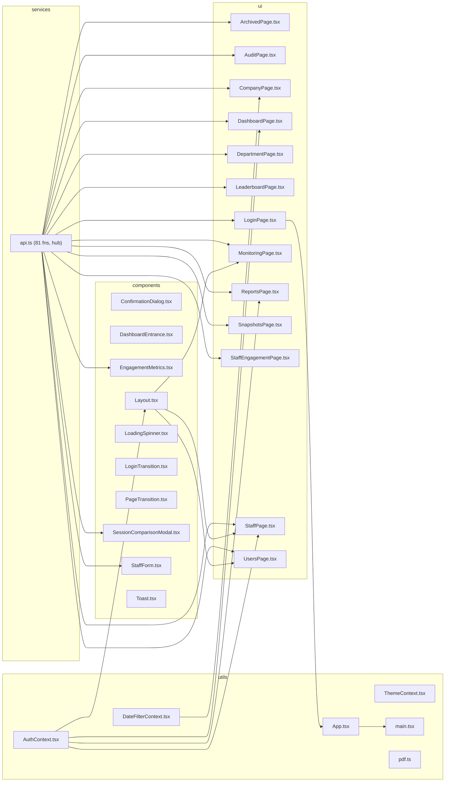

# SociHR — Pentest Scope & System Brief

**Repo:** `syaakiirr/hr` · **Tarikh:** 2026-09-09
**Dijana dengan:** GRASP (`grasp-mcp-server`, analyze + diagram + security) + inventori manual
**Nota GRASP:** pengesan route GRASP hanya sokong Express/FastAPI/Gin — endpoint ASP.NET di bawah
dienumerasi manual melalui attribute routing. Analisis C# GRASP: 0 isu dalam kod sumber
(17 amaran backend semuanya false-positive ke atas bundle JS dalam `wwwroot/`).

---

## 1. Gambaran sistem

| Komponen | Teknologi | Nota |
|---|---|---|
| Frontend | React 19 + TypeScript + Vite, Tailwind | Di-serve sebagai fail statik oleh backend (`MapFallbackToFile("index.html")`) — **same-origin** |
| Backend | ASP.NET Core 8 (C#), EF Core + Npgsql | REST JSON (camelCase), FluentValidation, rate limiting (`AspNetCoreRateLimit`) |
| Database | PostgreSQL (Supabase pooler, `aws-1-ap-southeast-2`) | Connection string via env `ConnectionStrings__DefaultConnection` |
| Hosting | Render (berdasar CORS origins + komen kod) | Frontend prod: `https://soci-hr.onrender.com`, `https://socihr.onrender.com`, `https://syaakiirr.onrender.com` |
| API base | `/api` (same-origin, `VITE_API_BASE_URL=/api`) | Health check tanpa auth: `GET /health` |
| PDF/Excel | QuestPDF + ClosedXML + SkiaSharp | Jana laporan via `ReportsController`, `MonitoringSessionController` |

**GRASP health:** frontend 89/100 (B) · backend 67/100 (D, diheret aset compiled `wwwroot/`) · root 64/100 (D) · 0 circular deps.

## 2. Aliran data (trust boundaries)

```mermaid
flowchart LR
    U[Pengguna / Attacker] -->|HTTPS| FE[React SPA\n(dihantar oleh backend)]
    FE -->|/api + JWT Bearer| API[ASP.NET Controllers\n+ FluentValidation]
    API -->|Rate limit by IP| RL{IpRateLimit}
    RL --> EF[EF Core + Npgsql]
    EF --> PG[(PostgreSQL\n11 jadual)]
    API -->|PDF/Excel| GEN[QuestPDF / ClosedXML]
    subgraph Auth
      LOGIN[POST /api/auth/login\nBCrypt verify] --> JWT[JWT HMAC-SHA256\n60 min]
      JWT --> RBAC{Roles:\nSuperAdmin / DeptAdmin}
    end
```

## 3. Model auth

- **Login:** `POST /api/auth/login` `{username, password}` → `{token, username, role, departmentId, departmentName}`. Rate limit 5/min.
- **2FA:** TOTP sebenar (RFC 6238, `OtpNet`, toleransi drift ±1 langkah). Aliran:
  `POST /api/auth/login` (password) → `{requires2FA, pendingToken}` (JWT 5-min,
  `purpose=2fa-pending`, ditolak middleware di semua endpoint kecuali verify) →
  `POST /api/auth/2fa/verify` `{pendingToken, code}` → token penuh. Enrolmen:
  `POST /api/auth/2fa/setup` (jana rahsia + `otpauth://` URL) →
  `POST /api/auth/2fa/enable` (sahkan kod) → aktif;
  `POST /api/auth/2fa/disable` (perlu kod semasa). UI: langkah kod 6-digit di LoginPage.
- **Lockout akaun:** 5 kegagalan berturut → kunci 15 min (`423` + header `Retry-After`).
  Per-akaun (tidak boleh dipintas via `X-Forwarded-For`). Kaunter reset bila berjaya.
- **JWT:** HMAC-SHA256, `Issuer=socihr-backend`, `Audience=socihr-frontend`, tamat 60 min. Claims: `NameIdentifier`, `Name`, `Role`, `DepartmentID` (pilihan).
- **Kunci JWT:** hardcoded dalam `appsettings.json` (`Jwt:Key`) + fallback sama dalam `Program.cs:108` dan `AuthController.cs:105`. Kunci ini **ter-commit dalam git** — sesiapa ada akses repo boleh menempa token mana-mana role. Sahkan sama ada env prod mengatasi nilai ini.
- **RBAC:** `[Authorize]` asas + `[Authorize(Roles="SuperAdmin")]` / `"SuperAdmin,DeptAdmin"`.
- **CORS:** allowlist 3 origin onrender + localhost; `AllowAnyHeader/Method`, tiada `AllowCredentials`.
- **Audit keselamatan:** jadual `SecurityAudit` (`AuditID, UserID, Username, Action, Details, IpAddress, CreatedAt`).
  Ditulis untuk: `login.success/failed/locked`, `login.2fa.success/failed`, `2fa.enabled/disabled`,
  `user.created/updated/deleted`, `staff.archived/restored/deleted`,
  `session.archived/restored/deleted`, `report.exported` (semua eksport PDF/Excel).
  Dibaca via `GET /api/audit/security` (SuperAdmin; tapis `action`, `username`, paginasi).
- **Rate limit:** login 5/min, 2FA 5/min, engagement 20/min, monitoringsession 10/min. Nota: IP client dibaca dari header `X-Forwarded-For` (`RealIpHeader`) — header ini boleh dipalsukan untuk memintas had berasaskan IP (lockout per-akaun di atas tidak terjejas).
- **Akaun seed:** pengguna `admin` auto-dicipta jika tiada; password dari env `ADMIN_PASSWORD` → `appsettings AdminCredentials` → fallback `"admin"`.

## 4. Inventori endpoint (11 controllers, ~60 routes)

Base: `api/[controller]`. Auth dicatat per controller; `[Authorize]` = mana-mana pengguna log masuk.

| Controller | Auth | Routes |
|---|---|---|
| `Auth` | campur | `GET schema` (SuperAdmin — dedah **full DB schema** via `information_schema`) · `POST login` (anon) · `POST 2fa/verify` (anon, tukar TOTP pending→penuh) · `POST 2fa/setup` (auth, enrol) · `POST 2fa/enable` (auth + kod) · `POST 2fa/disable` (auth + kod) |
| `Audit` | campur | `GET /` (auth, engagement audit — semak pendedahan data sensitif) · `GET security` (SuperAdmin, audit keselamatan) |
| `Users` | SuperAdmin | `GET /` · `POST /` · `PUT {id:guid}` · `DELETE {id:guid}` |
| `Staff` | campur | `GET /` · `GET paged` · `GET {id:guid}` · `POST /` · `PUT {id:guid}` · `DELETE {id:guid}` (SuperAdmin) · `PATCH {id}/toggle-status` · `GET engagement-stats` · `POST {id}/archive` (SuperAdmin) · `POST {id}/restore` (SuperAdmin) · `GET archived` (SuperAdmin) |
| `Department` | auth | `GET /` · `POST /` · `DELETE {id:guid}` |
| `Company` | auth | `GET /` · `POST /` · `DELETE {id:guid}` |
| `Platform` | auth | `GET /` |
| `Engagement` | SuperAdmin,DeptAdmin | `GET /` · `PATCH {id}/status` · `PATCH {id}/action` · `PATCH {id}/reason` · `POST bulk-update` |
| `MonitoringSession` | SuperAdmin,DeptAdmin | `GET /` · `GET {id}` · `POST /` · `PUT {id}` · `DELETE {id}` · `POST {id}/archive` · `POST {id}/restore` · `GET archived` · `PATCH posts/{postId}/link` · `POST {sessionId}/add-staff` · `POST multi-report` · `POST custom-report` · `GET {id}/report` (PDF) · `GET {id}/report-excel` · `POST multi-report-excel` |
| `Dashboard` | auth | `GET kpi` · `GET monthly` · `GET weekly` · `GET platform-comparison` · `GET staff-ranking` · `GET heatmap` · `GET company-performance` · `POST snapshot/create` · `GET snapshot/list` · `GET snapshot/{id}` · `DELETE snapshot/{id}` · `GET trend` · `GET leaderboard` · `GET session-comparison` |
| `Reports` | auth | `GET excel` · `POST custom-excel` · `GET pdf` (fail besar ~1000+ baris — semak parameter custom report → potensi formula/CSV injection, path traversal) |
| — | anon | `GET /health` (tiada DB) |

## 5. Model data (11 entiti → jadual)

`AppUser` (Users), `Department`, `Staff`, `Engagement`, `MonitoringSession`, `Platform`, `Company`, `SessionCompany`, `SessionPost`, `AuditTrail`, `DashboardSnapshot`. Skema penuh boleh dibaca (dengan kredensial SuperAdmin) via `GET /api/auth/schema`.

## 6. Kawasan tumpuan (pra-dapatan untuk pengesahan pentest)

> **Status 2026-09-09 — DIPERBAIKI + DIPERKUKUH sebelum pentest.** Item 1–4 di bawah telah
> diimplement dalam kod (lihat nota). Pentester diminta **mengesahkan fix** (retest),
> bukan menemui semula.

1. **[KRITIKAL → IMPLEMENTED] TOTP 2FA sebenar** — endpoint palsu (terima apa-apa PIN,
   kemudian 410) diganti implementasi RFC 6238 (`Otp.NET`, toleransi drift ±1 langkah).
   `POST /api/auth/login` → `{requires2FA, pendingToken}` (JWT 5-min `purpose=2fa-pending`,
   ditolak middleware di semua endpoint kecuali verify) → `POST /api/auth/2fa/verify`
   → token penuh. Enrolmen: `2fa/setup` → `2fa/enable` (sah kod) → aktif;
   `2fa/disable` (perlu kod semasa). UI langkah kod di LoginPage.
   Retest: kod rawak mesti 401; token pending cuba capai `GET /api/staff` mesti 401.
2. **[KRITIKAL → FIXED] Kunci JWT hardcoded ter-commit** — fallback hardcoded dibuang dari
   `Program.cs`, `AuthController.cs`, dan nilai dalam `appsettings.json` dikosongkan.
   Aplikasi kini **gagal-start (fail-closed)** jika tiada kunci. ⚠️ **Tindakan operator
   WAJIB sebelum deploy:** set env `JWT__Key` kepada kunci rawak baharu (min 32 aksara)
   di Render; kunci lama dianggap bocor selama-lamanya. Retest: cuba tempa token
   dengan kunci lama → mesti ditolak (401).
3. **[TINGGI → FIXED] Eskalasi `admin` automatik** — blok auto-heal dalam `Login`
   (`username=="admin"` / role kosong → SuperAdmin) telah dibuang; peranan kini 100%
   dari DB. Migrasi startup dihadkan: `Admin`→`SuperAdmin` (nama warisan) dikekalkan,
   tetapi role NULL/kosong kini diisi `DeptAdmin` (default model, bukan SuperAdmin).
   Seed `admin` tidak lagi menggunakan password default `"admin"` — jika env
   `ADMIN_PASSWORD` tiada, seed dilangkau dengan amaran. ⚠️ **Tindakan operator:**
   set `ADMIN_PASSWORD` yang kukuh di Render sebelum deploy pertama (atau cipta admin
   sedia ada kekal tanpa perubahan).
4. **[SEDERHANA] Fallback password plaintext** — `AuthController.cs`: jika hash tersimpan bukan BCrypt, perbandingan string biasa diterima. Semak sama ada baris Users berkataan laluan plaintext.
5. **[SEDERHANA → SEBAHAGIAN DITANGANI] Bypass rate-limit via `X-Forwarded-For`** — had IP masih boleh dipintas dengan putaran header, tetapi **lockout per-akaun kini wujud**: 5 kegagalan berturut → kunci 15 min (`423` + `Retry-After`), tidak terjejas oleh spoofing IP. Retest: 6 login gagal berturut → akaun terkunci walaupun `X-Forwarded-For` diputar setiap request.
8. **[BARU] Audit keselamatan** — jadual `SecurityAudit`: `login.success/failed/locked`, `login.2fa.*`, `2fa.enabled/disabled`, `user.created/updated/deleted`, `staff/session.archived/restored/deleted`, `report.exported`. Retest: lakukan aksi → semak `GET /api/audit/security` (SuperAdmin).
6. **[RENDAH] Pendedahan skema DB** — `GET /api/auth/schema` (perlu SuperAdmin; berguna pasca-eksploitasi).
7. **Permukaan tambahan:** penjanaan PDF/Excel (`ReportsController.cs`, 1000+ baris) — uji input laporan custom; `DELETE/POST archive/restore` — uji IDOR merentas department (DeptAdmin disekat secara skop? semak penguatkuasaan `DepartmentID` selain di claim).

> Dapatan GRASP `SQL injection`/`XSS` pada fail `*.tsx`/`wwwroot/*.js` disahkan **false-positive** (template literal UI, bukan query SQL) — nyah-utamakan.

## 7. Keperluan ujian & cadangan skop

- **Akaun ujian diperlukan:** 1× SuperAdmin, 1× DeptAdmin (dengan DepartmentID ditetapkan), 1× pengguna biasa tanpa role khas (jika wujud).
- **Dalam skop:** app Render prod + API `/api/*` + SPA.
- **Luar skop (cadangan):** infra Supabase/Rerender asas, DoS volumetrik (rate limit akan menendang).
- **Artefak GRASP disertakan:** `grasp-report.json` (data penuh), `grasp-frontend-mcp.sarif` (90 dapatan mesin), gambarajah Mermaid di bawah.

## 8. Gambarajah seni bina frontend (GRASP, Mermaid)

> Render: tampal dalam blok ```mermaid di GitHub / wiki / Notion. Nod `api.ts` tunggal dalam layer `services` = god-hub (blast radius 72).


