# SociHR — Manual Pengguna (User Manual)
### Social Media Engagement Monitor for HR Teams
**Versi 1.0 | 6 Oktober 2026 | Untuk Kegunaan Client**

> Dokumen ini ditulis untuk **orang bukan-IT**. Jika anda boleh guna Facebook dan Excel, anda boleh guna SociHR. Tiada istilah teknikal yang susah — semua diterangkan dengan bahasa harian.

---

## Isi Kandungan

1. [Apa Itu SociHR?](#1-apa-itu-socihr)
2. [Siapa Guna Sistem Ini? (Peranan Pengguna)](#2-siapa-guna-sistem-ini-peranan-pengguna)
3. [Cara Masuk Sistem (Login)](#3-cara-masuk-sistem-login)
4. [Peta Sistem — Menu Utama](#4-peta-sistem--menu-utama)
5. [Aliran Kerja Harian HR (Gambaran 5 Minit)](#5-aliran-kerja-harian-hr-gambaran-5-minit)
6. [Modul 1: Dashboard](#6-modul-1-dashboard-laman-utama)
7. [Modul 2: Staff (Senarai Pekerja)](#7-modul-2-staff-senarai-pekerja)
8. [Modul 3: Staff Engagement / Staff Ticks](#8-modul-3-staff-engagement--staff-ticks)
9. [Modul 4: Monitoring (Sesi Pemantauan)](#9-modul-4-monitoring-sesi-pemantauan)
10. [Modul 5: Leaderboard (Ranking)](#10-modul-5-leaderboard-ranking)
11. [Modul 6: Company & Department](#11-modul-6-company--department-syarikat--jabatan)
12. [Modul 7: Reports (Laporan Excel / PDF)](#12-modul-7-reports-laporan-excel--pdf)
13. [Modul 8: Snapshots (Gambar Keadaan)](#13-modul-8-snapshots-gambar-keadaan)
14. [Modul 9: Audit Trail (Buku Log)](#14-modul-9-audit-trail-buku-log)
15. [Modul 10: Archived & Users](#15-modul-10-archived--users-arkib--pengguna)
16. [Penapis Tarikh — Konsep Penting](#16-penapis-tarikh--konsep-penting)
17. [Masalah Biasa & Penyelesaian (Troubleshooting)](#17-masalah-biasa--penyelesaian-troubleshooting)
18. [Soalan Lazim (FAQ)](#18-soalan-lazim-faq)
19. [Glosari — Istilah Teknikal Dalam Bahasa Mudah](#19-glosari--istilah-teknikal-dalam-bahasa-mudah)
20. [Maklumat Serahan Projek (Untuk Simpanan Client)](#20-maklumat-serahan-projek-untuk-simpanan-client)

---

## 1. Apa Itu SociHR?

**SociHR = satu tempat untuk HR pantau siapa buat kerja media sosial syarikat.**

Bayangkan syarikat anda suruh semua staf like / komen / share post Instagram, TikTok dan Facebook syarikat. Tanpa sistem, HR kena:

- Buka 3 apps berbeza,
- Tanya satu-satu staf "dah buat ke belum?",
- Catat dalam Excel manual.

**Dengan SociHR**, semua itu jadi automatik dalam satu laman web:

| Tanpa SociHR | Dengan SociHR |
|---|---|
| Semak IG, TikTok, FB satu-satu | Satu dashboard tunjuk semua platform |
| Tanya staf manual | Sistem rekod siapa dah engage / siapa miss |
| Excel kena taip sendiri | Tekan satu butang → Excel / PDF siap |
| Tiada bukti | Setiap perubahan ada log siapa, bila, apa (Audit Trail) |

**Analogi mudah:** SociHR macam *buku kehadiran*, tapi untuk kehadiran media sosial.

---

## 2. Siapa Guna Sistem Ini? (Peranan Pengguna)

Ada **2 jenis pengguna**. Fikirkan macam **Manager Besar** dan **Ketua Jabatan**.

### SuperAdmin (Manager Besar / HQ HR)
- Nampak **SEMUA** staf, SEMUA syarikat, SEMUA jabatan.
- Boleh tambah / padam syarikat, jabatan, pengguna.
- Boleh tengok Audit Trail, Snapshots, Archived.
- Boleh buat laporan untuk mana-mana jabatan.

### DeptAdmin (Ketua Jabatan / HR Cawangan)
- Nampak **jabatan sendiri sahaja**.
- Boleh urus staf jabatan sendiri, buat monitoring, tengok dashboard & laporan jabatan sendiri.
- **Tidak boleh** masuk menu Company, Departments, Audit, Snapshots, Archived, Users.

> **Cara ingat:** Kalau menu itu tak muncul di sidebar anda, maksudnya peranan anda tak dibenarkan masuk — itu normal, bukan rosak.

---

## 3. Cara Masuk Sistem (Login)

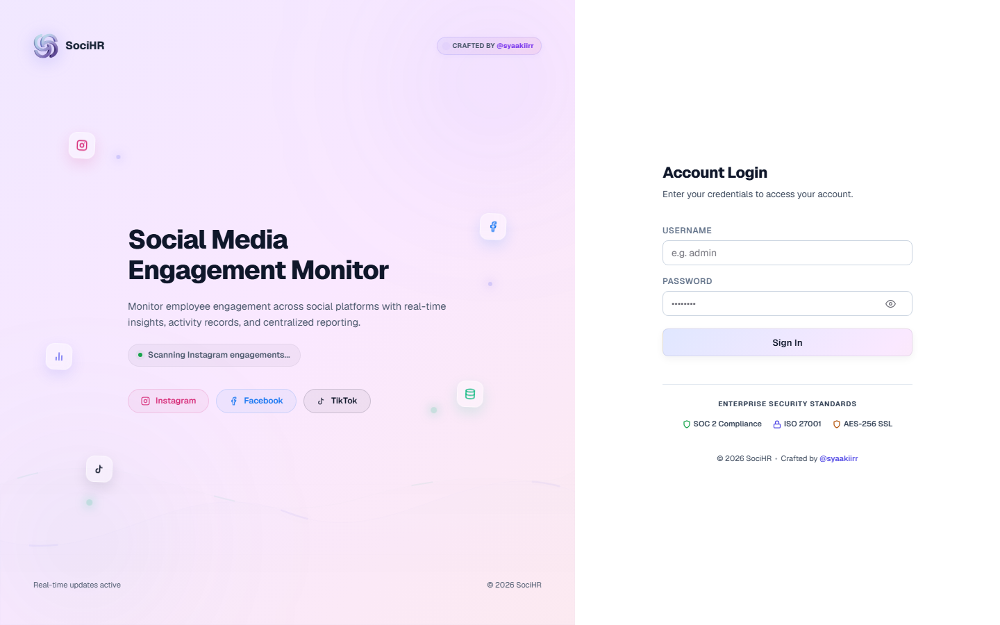

**Langkah-langkah:**

1. Buka browser (Chrome / Edge disyorkan) di komputer atau telefon.
2. Pergi ke alamat laman web yang diberi oleh IT (contoh: `https://socihr.syarikat-anda.com`).
3. Anda akan nampak **Landing Page** — tekan butang **Login / Masuk**.
4. Masukkan **Username** dan **Password** yang diberi oleh admin.
5. Tekan **Log Masuk**.
6. Jika syarikat aktifkan keselamatan tambahan (2FA), masukkan **6-digit kod** dari app authenticator anda.
7. Anda akan dibawa ke **Dashboard**.

**Nota penting:**
- Jika salah password 5 kali berturut-turut, akaun dikunci sementara (keselamatan). Tunggu 1 minit dan cuba lagi, atau hubungi SuperAdmin.
- Jangan kongsi password. Setiap orang ada akaun sendiri supaya log tahu *siapa* buat apa.
- Untuk keluar, tekan ikon profil / **Logout** di sidebar.

---

## 4. Peta Sistem — Menu Utama

Selepas login, menu di sebelah kiri (sidebar) ialah pusat navigasi anda:

| Menu | Fungsi Dalam Satu Ayat | Siapa Boleh Guna |
|---|---|---|
| **Dashboard** | Gambar keseluruhan: berapa % siap, siapa top / bottom | Semua |
| **Staff** | Buku alamat pekerja: tambah, kemaskini, aktif/tak aktif | Semua (skop sendiri) |
| **Staff Engagement** | Senarai "siapa dah like/komen/share, siapa belum" | Semua |
| **Monitoring** | Sesi pemantauan: post apa, bila, syarikat mana terlibat | Semua |
| **Leaderboard** | Papan ranking: siapa paling rajin | Semua |
| **Reports** | Cetak laporan Excel / PDF untuk bos | Semua |
| **Company** | Senarai syarikat di bawah group | SuperAdmin sahaja |
| **Departments** | Senarai jabatan | SuperAdmin sahaja |
| **Snapshots** | Simpan "gambar" dashboard pada tarikh tertentu | SuperAdmin sahaja |
| **Audit Trail** | Buku log: siapa tukar apa, bila | SuperAdmin sahaja |
| **Archived** | Fail lama / staf berhenti (stor) | SuperAdmin sahaja |
| **Users** | Urus akaun login pengguna sistem | SuperAdmin sahaja |

---

## 5. Aliran Kerja Harian HR (Gambaran 5 Minit)

Ini rutin biasa seorang HR guna SociHR. Ikut turutan ini:

```
PAGI
 1. Login → buka Dashboard
 2. Tengok penapis tarikh (contoh: "Bulan Ini")
 3. Tengok KPI: Completion Rate naik atau turun?
 4. Tengok Bottom Staff — siapa perlu diingatkan?

TENGAH HARI
 5. Buka Monitoring → pilih sesi hari ini
 6. Tick (tanda) engagement staf: Completed / Missed
 7. Kalau staf buat pukal (banyak post sekali), guna "Mark All"

MINGGUAN / BULANAN
 8. Buka Leaderboard → screenshot / bincang dalam meeting
 9. Buka Reports → muat turun Excel/PDF → hantar ke bos
10. (SuperAdmin) Buka Snapshots → simpan keadaan bulan ini sebagai rekod
```

---

## 6. Modul 1: Dashboard (Laman Utama)

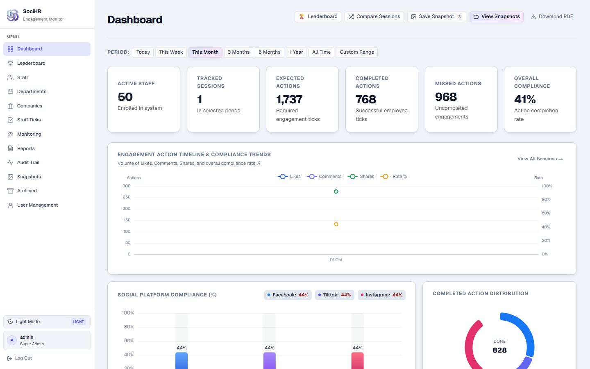

**Apa dia:** Skrin pertama lepas login. Macam papan pemuka kereta — tunjuk kesihatan keseluruhan dalam satu pandangan.

**Apa yang anda nampak:**

1. **Kad KPI (nombor besar di atas):**
   - *Total Posts* — berapa post perlu di-engage dalam tempoh dipilih.
   - *Engaged / Completed* — berapa dah siap.
   - *Missed* — berapa belum buat.
   - *Completion Rate %* — peratus siap. Ini nombor paling penting untuk bos.

2. **Graf:**
   - *Trend Bulanan / Mingguan* — garisan naik/turun. Naik = bagus.
   - *Ikut Platform* — Instagram vs TikTok vs Facebook, mana paling aktif.
   - *Ikut Syarikat* — syarikat mana paling rajin.

3. **Senarai Top / Bottom Staff** — 5 paling rajin dan 5 paling ketinggalan.

**Cara guna:**
1. Ubah **penapis tarikh** di atas (Hari Ini / Minggu Ini / Bulan Ini / Custom Range).
2. Semua nombor dan graf akan berubah ikut tarikh itu.
3. Tekan butang **Save Snapshot** (SuperAdmin) untuk simpan paparan ini sebagai rekod.
4. Tekan butang **Muat Turun PDF** untuk simpan gambar dashboard.

> **Tip untuk non-IT:** Kalau bos tanya "bulan ni prestasi macam mana?", buka Dashboard, set tarikh bulan ini, baca Completion Rate %. Itu jawapannya.

---

## 7. Modul 2: Staff (Senarai Pekerja)

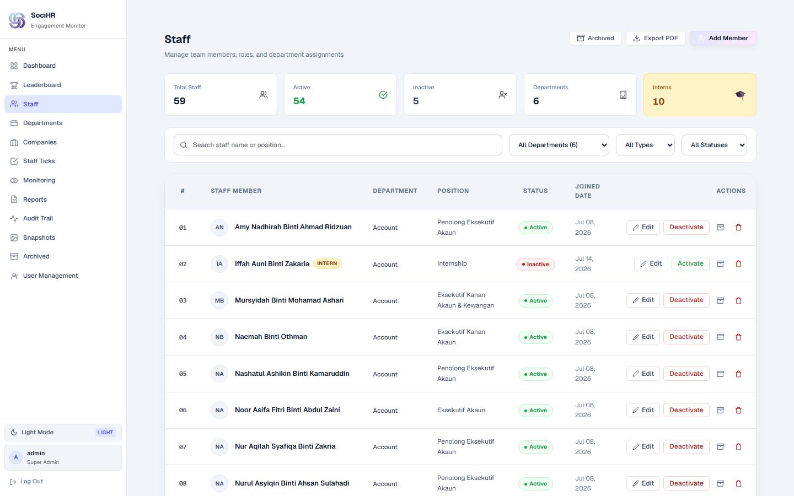

**Apa dia:** Buku alamat digital semua pekerja.

**Maklumat setiap staf:** Nama penuh, Jabatan, Jawatan (Position), Status (Aktif / Tidak Aktif).

**Cara guna:**

- **Cari staf:** Taip nama dalam kotak Search. Boleh tapis ikut Jabatan dan Status.
- **Tambah staf baru:**
  1. Tekan **+ Add Staff / Tambah**.
  2. Isi Nama, pilih Jabatan, isi Jawatan.
  3. Tekan **Simpan**.
- **Kemaskini:** Tekan ikon **Edit (pensel)** pada baris staf → ubah → Simpan.
- **Tukar status:** Tekan toggle **Aktif/Tidak Aktif**. Staf tidak aktif tidak dikira dalam laporan.
- **Padam / Arkib:** Tekan **Archive** untuk simpan staf berhenti ke stor (boleh restore). Tekan **Delete** hanya jika rekod salah masuk.
- **Tengok profil:** Klik nama staf untuk buka **Staff Profile** — tunjuk sejarah engagement dia seorang.

---

## 8. Modul 3: Staff Engagement / Staff Ticks

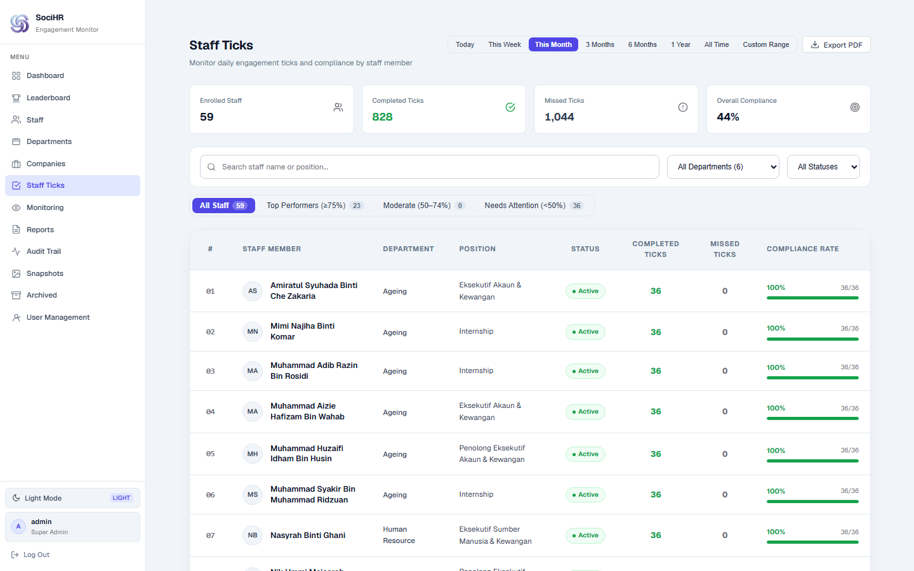

**Apa dia:** Senarai semak "tugasan media sosial". Setiap baris = seorang staf + satu post.

**Status yang anda akan jumpa:**
- **Completed (Hijau ✓)** — staf dah like/komen/share.
- **Missed (Merah ✗)** — staf belum buat / tak buat.
- **Pending (Kuning ⏳)** — belum disemak.

**Cara guna (tick):**
1. Buka **Staff Engagement** atau buka dari dalam **Monitoring**.
2. Cari staf / tapis ikut nama, jabatan, syarikat.
3. Tekan **✓** untuk tanda Completed, atau **✗** untuk Missed.
4. Jika perlu bagi alasan (contoh: "cuti sakit"), tekan **Reason / Nota** dan taip sebab.
5. Perubahan disimpan automatik dan masuk ke **Audit Trail**.

**Fungsi pukal (bulk):**
- Butang **"Mark All 3"** — kalau seorang staf buat 3 post sekali gus, tekan sekali sahaja, kemudian isi alasan dan sahkan. Jimat masa.

> **Analogi:** Macam cikgu tanda kehadiran kelas. ✓ = hadir, ✗ = ponteng.

---

## 9. Modul 4: Monitoring (Sesi Pemantauan)

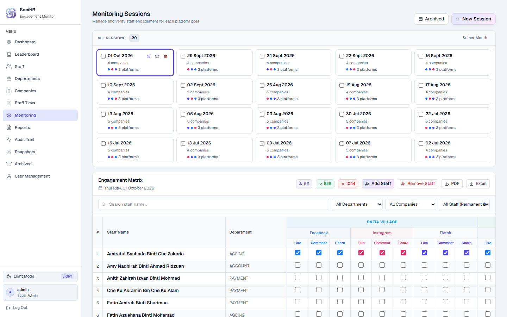
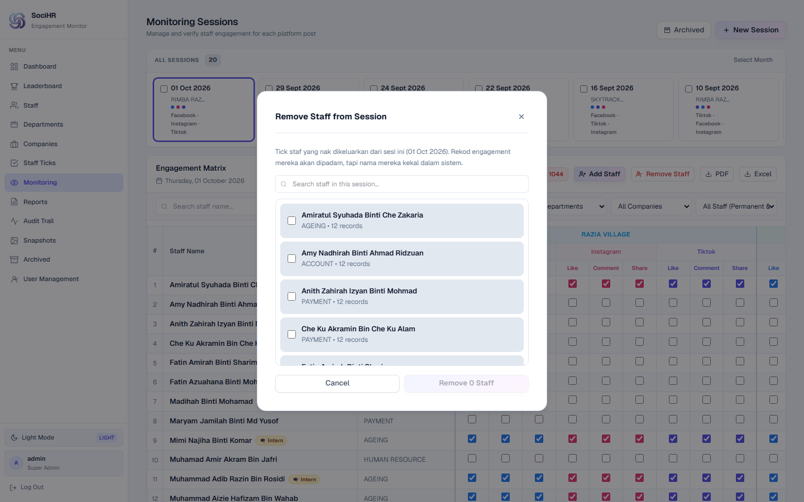

**Apa dia:** Fail untuk setiap "kempen". Contoh: "Kempen Raya 2026 — Post IG 5 April".

Setiap sesi simpan: **Nama sesi, Tarikh, Link post (IG/TikTok/FB), Syarikat terlibat.**

**Cara guna:**

- **Buat sesi baru (3 langkah wizard):**
  1. Tekan **+ New Session**.
  2. Langkah 1: Isi tarikh dan nama sesi.
  3. Langkah 2: Pilih syarikat yang terlibat.
  4. Langkah 3: Tampal link post (URL Instagram/TikTok/Facebook) → **Simpan**.
- **Semak sesi:** Klik sesi untuk nampak senarai engagement di dalamnya, kemudian tick seperti dalam Modul 3.
- **Keluarkan staf dari sesi (contoh: kontrak dah habis):** Di atas table, tekan butang merah **Remove Staff** (sebelah *Add Staff*) → tick nama staf yang nak dikeluarkan (boleh pilih ramai, ada kotak search) → tekan **Remove** → sahkan dalam popup. Semua rekod engagement mereka dalam sesi itu akan dipadam, tapi nama mereka kekal dalam sistem.
- **Arkib sesi:** Sesi lama boleh di-archive supaya senarai kekal kemas. Boleh restore bila-bila masa dari menu Archived.

---

## 10. Modul 5: Leaderboard (Ranking)

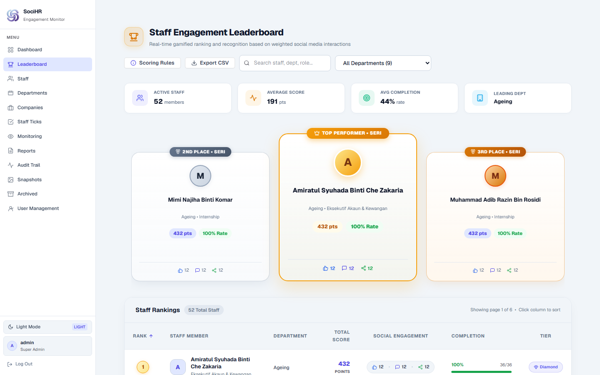

**Apa dia:** Papan ranking macam liga bola — siapa No.1, siapa tercorot.

**Cara guna:**
1. Pilih jabatan (atau "Semua").
2. Cari nama jika perlu.
3. Klik tajuk kolum untuk susun (sort) ikut rank / nama / %.
4. Tekan **Peraturan / Rules** untuk faham cara markah dikira.
5. Sesuai untuk tayang dalam meeting atau tampal di papan kenyataan.

---

## 11. Modul 6: Company / Department (Syarikat / Jabatan)

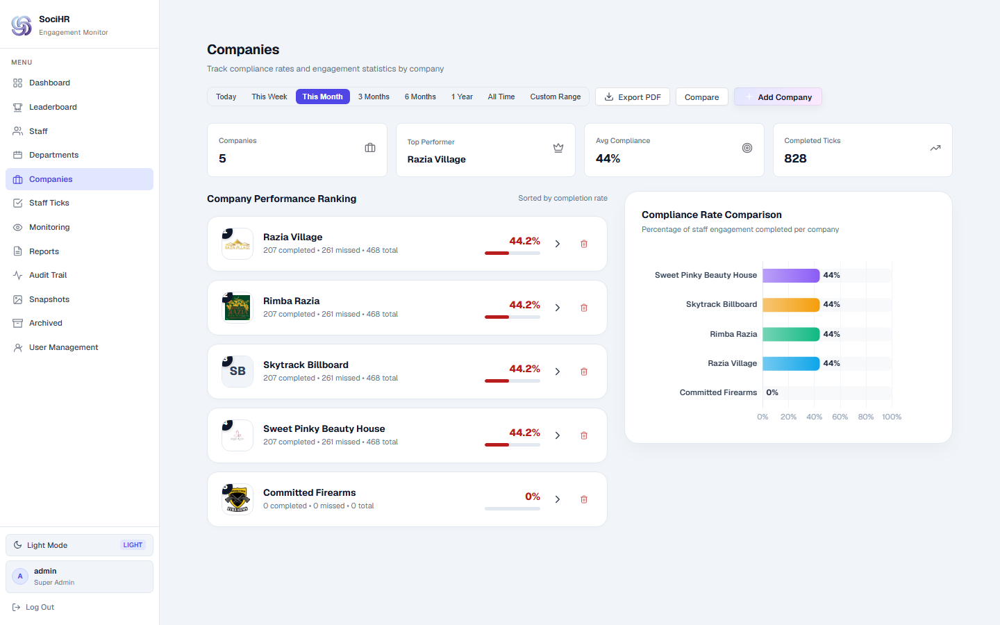
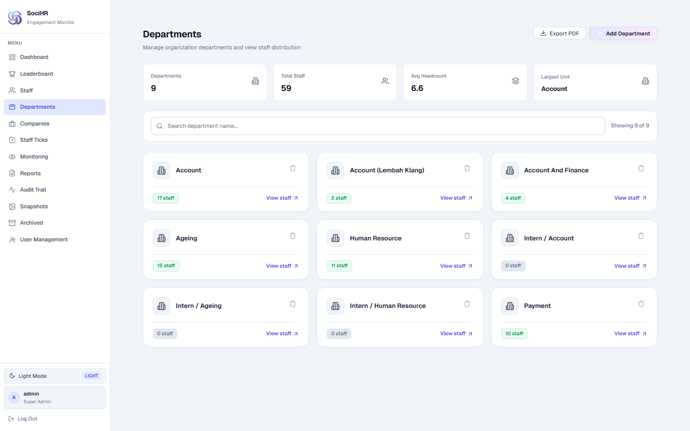

**Hanya SuperAdmin.**

- **Company:** Senarai syarikat dalam group (contoh: Syarikat A, Syarikat B). Tekan tambah/padam. Klik satu syarikat untuk buka **Company Profile** (prestasi syarikat itu). Ada juga **Compare** untuk banding 2 syarikat sebelah-sebelah.
- **Departments:** Senarai jabatan (contoh: HR, Marketing, Sales). Tambah/padam di sini. Jabatan digunakan untuk tapis staf dan laporan.

> Kalau anda DeptAdmin dan tak nampak menu ini — itu biasa. Minta SuperAdmin tambahkan jabatan/syarikat untuk anda.

---

## 12. Modul 7: Reports (Laporan Excel / PDF)

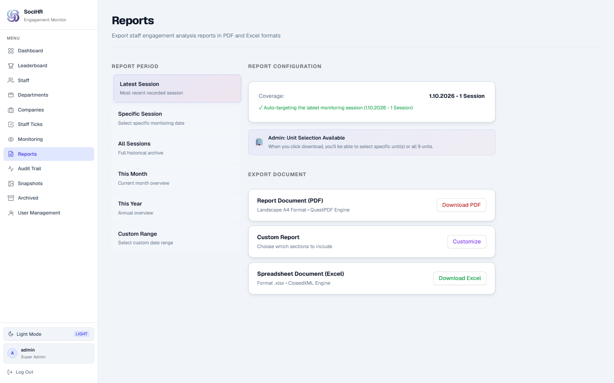

**Apa dia:** Mesin cetak laporan untuk bos. Paling kerap guna masa handover.

**Jenis laporan:**
1. **Latest (Terkini)** — laporan sesi paling baru.
2. **By Session Date** — pilih tarikh sesi tertentu.
3. **Custom Range** — pilih tarikh mula dan tamat sendiri.
4. **Custom Excel (paling power):** Anda boleh tick bahagian mana nak masuk:
   - Kad ringkasan
   - Ranking staf
   - Platform ikut syarikat
   - Trend harian
   - Senarai sesi monitoring
   - Jadual staf

**Preset pantas:** `Executive` (ringkas untuk CEO), `Full Audit` (lengkap untuk audit), `Staff Only` (senarai staf sahaja).

**Cara guna:**
1. Buka **Reports**.
2. Pilih jenis laporan dan tarikh.
3. (SuperAdmin) Pilih jabatan/unit — atau "__all__" untuk semua.
4. Tekan **Preview** untuk semak dulu.
5. Tekan **Download PDF** atau **Download Excel**.
6. Fail akan dimuat turun — boleh terus email kepada bos.

---

## 13. Modul 8: Snapshots (Gambar Keadaan)

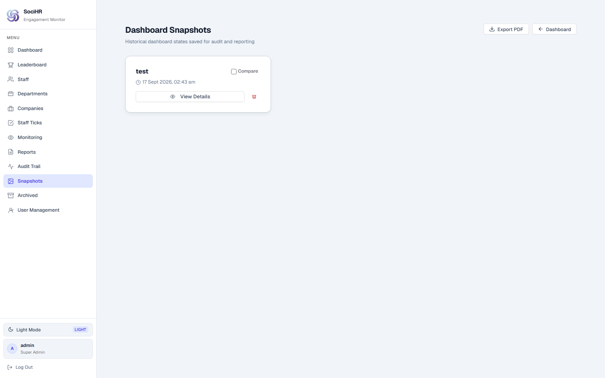

**Hanya SuperAdmin. Analogi:** Macam ambil gambar (screenshot) dashboard dan simpan dalam album dengan nota.

**Kenapa penting:** Bulan Disember nanti, bos tanya "bulan Julai prestasi macam mana?" — anda tak perlu kira semula. Buka snapshot Julai.

**Cara guna:**
1. Di Dashboard, tekan **Save Snapshot** → beri Nama (contoh: "Julai 2026 — Sebelum Kempen Merdeka") + Nota + julat tarikh → Simpan.
2. Buka menu **Snapshots** untuk senarai semua simpanan.
3. Tekan **View** untuk lihat, **Compare** (pilih 2) untuk banding sebelah-sebelah, **Delete** untuk padam.

---

## 14. Modul 9: Audit Trail (Buku Log)

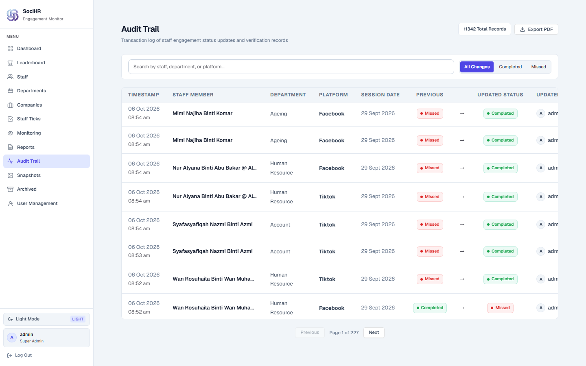

**Hanya SuperAdmin. Analogi:** CCTV bertulis sistem.

Setiap kali seseorang tukar status engagement (contoh: Pending → Completed), sistem catat:
- **Siapa** buat (nama pengguna)
- **Bila** (tarikh + masa)
- **Apa** berubah (status lama → status baru)
- Staf dan platform terlibat

**Cara guna:**
1. Buka **Audit**.
2. Taip nama staf / platform dalam Search, atau tapis ikut status.
3. Halaman disusun 50 rekod sehalaman — guna Next/Prev untuk navigasi.
4. Boleh muat turun sebagai PDF sebagai bukti audit.

> Jika ada pertikaian ("saya dah buat tapi sistem kata miss"), rujuk sini sebagai bukti.

---

## 15. Modul 10: Archived / Users (Arkib / Pengguna)

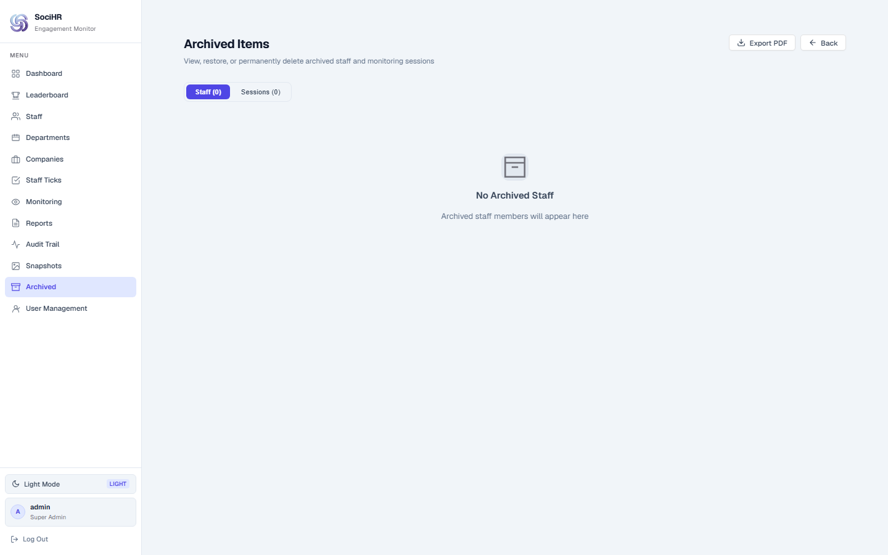
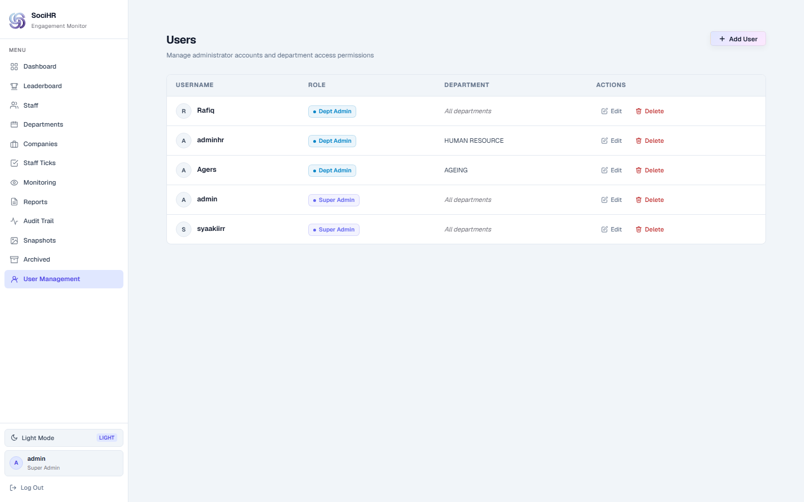

**Archived (SuperAdmin sahaja):** Stor untuk staf berhenti dan sesi lama. Fungsi: **Restore** (keluarkan balik) atau padam kekal. Prinsip: jangan padam terus — arkibkan dahulu.

**Users (SuperAdmin sahaja):** Urus akaun login.
- Tambah pengguna baru: isi username, password sementara, pilih peranan (SuperAdmin / DeptAdmin + jabatan).
- Reset password jika pengguna lupa.
- Nyahaktif akaun staf yang berhenti supaya tidak boleh login lagi.

---

## 16. Penapis Tarikh — Konsep Penting

Hampir semua skrin (Dashboard, Leaderboard, Reports) ikut **satu penapis tarikh yang sama**.

Pilihan biasa:
- **Today (Hari Ini)**
- **This Week (Minggu Ini)**
- **This Month (Bulan Ini)**
- **Custom Range (Pilih Sendiri)** — isi Tarikh Mula dan Tarikh Tamat.

> **Peraturan emas:** Jika nombor nampak pelik/kosong, semak penapis tarikh dahulu. 90% "masalah" sebenarnya cuma salah tarikh.

---

## 17. Masalah Biasa & Penyelesaian (Troubleshooting)

| Masalah | Punca Biasa | Apa Nak Buat |
|---|---|---|
| Tak boleh login | Salah taip password / akaun dikunci | Semak Caps Lock, tunggu 1 min, hubungi SuperAdmin reset |
| Nombor kosong / 0 | Penapis tarikh salah | Tukar ke Bulan Ini / Custom Range yang betul |
| Menu hilang | Anda DeptAdmin | Normal — minta SuperAdmin bantu |
| Butang tick tak jalan / loading lama | Internet perlahan | Refresh page, cuba lagi. Jangan tekan banyak kali |
| Laporan Excel tak keluar | Tarikh mula > tarikh tamat | Betulkan: Mula mesti lebih awal dari Tamat |
| Staf baru tak muncul dalam laporan | Status Inactive / salah jabatan | Semak di Staff Page, tukar ke Active |
| Lupa password | Biasa berlaku | Minta SuperAdmin reset di menu Users |

Jika masih gagal selepas langkah di atas, catat: (1) apa anda tekan, (2) mesej error, (3) screenshot — dan hantar kepada IT support.

---

## 18. Soalan Lazim (FAQ)

**Q1: Perlu install apa-apa?**
Tidak. Buka browser sahaja. Berfungsi di komputer dan telefon.

**Q2: Data selamat ke?**
Ya. Login dilindungi password + (pilihan) kod 2FA. Setiap perubahan direkod dalam Audit Trail. Jangan kongsi akaun.

**Q3: Boleh guna untuk banyak syarikat?**
Ya. Itu kekuatan utama SociHR — satu dashboard untuk banyak syarikat dan banyak platform (IG, TikTok, FB).

**Q4: Apa beza Archive dan Delete?**
Archive = simpan dalam stor (boleh kembalikan). Delete = padam terus (tidak boleh undur). Sentiasa Archive dahulu.

**Q5: Laporan apa patut hantar kepada CEO?**
Guna Reports → preset **Executive** → Download PDF. Ringkas dan mudah dibaca.

**Q6: Bagaimana nak bukti staf dah buat kerja?**
Dua tempat: (1) Staff Engagement tunjuk Completed, (2) Audit Trail tunjuk siapa sahkan dan bila.

**Q7: Sistem support bahasa apa?**
Antaramuka dalam Bahasa Inggeris. Manual ini dalam Bahasa Melayu untuk mudahkan handover.

---

## 19. Glosari — Istilah Teknikal Dalam Bahasa Mudah

| Istilah Dalam Sistem | Maksud Mudah |
|---|---|
| Dashboard | Papan pemuka — ringkasan keseluruhan |
| KPI | Nombor penting (contoh: % siap) |
| Engagement / Tick | Tindakan staf: like, komen, share |
| Monitoring Session | Satu kempen / satu batch post untuk dipantau |
| Leaderboard | Papan ranking |
| Snapshot | Gambar simpanan keadaan pada satu tarikh |
| Audit Trail | Buku log / rekod siapa buat apa |
| Archived | Stor fail lama |
| SuperAdmin / DeptAdmin | Manager Besar / Ketua Jabatan |
| Completion Rate | Peratus siap (siap ÷ jumlah × 100) |
| Platform | IG / TikTok / FB |
| 2FA | Kod keselamatan 6-digit tambahan |

---

## 20. Maklumat Serahan Projek (Untuk Simpanan Client)

Bahagian ini untuk rekod rasmi penyerahan. Non-IT boleh skip, tapi simpan untuk IT client.

**Nama Sistem:** SociHR — Social Media Engagement Monitor for HR
**Dibangunkan oleh:** @syaakiirr
**Teknologi:**
- Frontend: React 19 + TypeScript + Vite (folder `socihr-frontend/`)
- Backend: .NET 8 Web API (folder `socihr-backend/`, endpoint bermula `/api`)
- Database: PostgreSQL (Supabase) + Entity Framework
- Laporan: Excel & PDF (jsPDF), Graf: ECharts

**Struktur folder utama:**
```
hr/
├── socihr-frontend/   → laman web (apa pengguna nampak)
│   └── src/pages/     → setiap menu (DashboardPage, StaffPage, ...)
├── socihr-backend/    → enjin/logik (API)
│   ├── Controllers/   → Auth, Staff, Engagement, MonitoringSession, Reports, Dashboard, Audit, Company, Department, Platform, Users
│   ├── Models/        → struktur data (Staff, Engagement, Session, dsb.)
│   └── *.sql          → skrip database
└── tests/             → ujian automatik (Playwright + xUnit)
```

**Akaun & Keselamatan:**
- Password disulitkan (BCrypt). Token login sah 60 minit.
- Kadar had login: 5 cubaan seminit (anti-brute-force).
- Peranan dikuatkuasa di backend (SuperAdmin / DeptAdmin).
- Sila tukar `ADMIN_PASSWORD` default dan kunci JWT selepas terima projek. Jangan dedahkan connection string.

**Cara hidupkan (ringkas untuk IT):**
1. Backend: set env `ConnectionStrings__DefaultConnection`, `Jwt__Key`, `ADMIN_PASSWORD` → `dotnet run`.
2. Frontend: `npm install` → `npm run build` → host folder `dist/`.
3. Pastikan backend `/api` boleh dicapai dari frontend.

**Apa yang diserahkan:**
- Kod sumber penuh (frontend + backend)
- Manual ini
- Skrip SQL database
- Ujian automatik (frontend E2E + backend unit/integration)

**Penyelenggaraan disyorkan:** Backup database mingguan. Semak menu Users suku tahunan (buang akaun staf berhenti). Simpan snapshot bulanan sebelum tutup bulan.

---

*— Tamat Manual. Jika ada soalan semasa handover, rujuk pembangun asal dengan menyertakan nombor modul di atas (contoh: "Modul 7 Reports tak keluar"). Terima kasih kerana menggunakan SociHR.*
